# Diagramas de arquitectura de Valora

Los 14 diagramas del Documento de arquitectura v1 (corte 1). Cada figura tiene su imagen `.png` y su fuente Mermaid `.mmd`; para modificar un diagrama se edita el `.mmd` y se vuelve a generar la imagen con `npx @mermaid-js/mermaid-cli -i archivo.mmd -o archivo.png -s 2 -b white`.

| # | Diagrama | Tipo |
|---|---|---|
| 0 | [Vista general del sistema](#0) | Diagrama de flujo de alto nivel |
| 1 | [C4 nivel 1 · Contexto](#1) | Modelo C4 · obligatorio |
| 2 | [C4 nivel 2 · Contenedores](#2) | Modelo C4 · obligatorio |
| 3 | [C4 nivel 3 · Componentes del backend](#3) | Modelo C4 · partes críticas |
| 4 | [Reglas de dependencia entre módulos](#4) | Diagrama de paquetes |
| 5 | [Casos de uso por actor](#5) | UML · casos de uso |
| 6 | [Secuencia · registrar un precio](#6) | UML · secuencia |
| 7 | [Secuencia · consultar y comparar](#7) | UML · secuencia |
| 8 | [Secuencia · precio oficial y promoción](#8) | UML · secuencia · corte 3 |
| 9 | [Ciclo de vida de un precio](#9) | UML · máquina de estados |
| 10 | [Flujo de moderación](#10) | Diagrama de actividad |
| 11 | [Modelo de datos](#11) | Diagrama entidad-relación |
| 12 | [Despliegue](#12) | UML · despliegue |
| 13 | [Evolución: del núcleo al módulo comercial](#13) | Diagrama de impacto |

## 0. Vista general del sistema

*Diagrama de flujo de alto nivel*

Resume todo Valora en una sola imagen: de dónde salen los precios, cómo entran, cómo se valida su confianza y qué termina viendo cada persona.

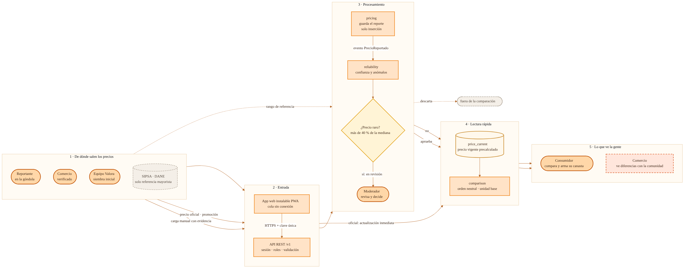

- Léelo de arriba abajo en cinco etapas: fuentes, entrada, procesamiento, lectura rápida y lo que ve la gente.
- El rombo es la regla de anómalos: si un precio se aleja más de 40 % de la mediana, pasa por un moderador antes de mostrarse.
- El precio oficial de un comercio salta directo a la lectura rápida; por eso aparece en segundos (EC-02).
- SIPSA solo aporta un rango de referencia; nunca se muestra como precio de una tienda (ADR-011).

**Relación:** ADR-001 · ADR-004 · ADR-006 · ADR-011 · EC-02 · EC-03

Fuente: [`00-alto-nivel.mmd`](00-alto-nivel.mmd)

## 1. C4 nivel 1 · Contexto

*Modelo C4 · obligatorio*

Muestra a Valora como una sola caja y quiénes la usan: los cuatro actores de la guía y los dos sistemas externos con los que se relaciona.

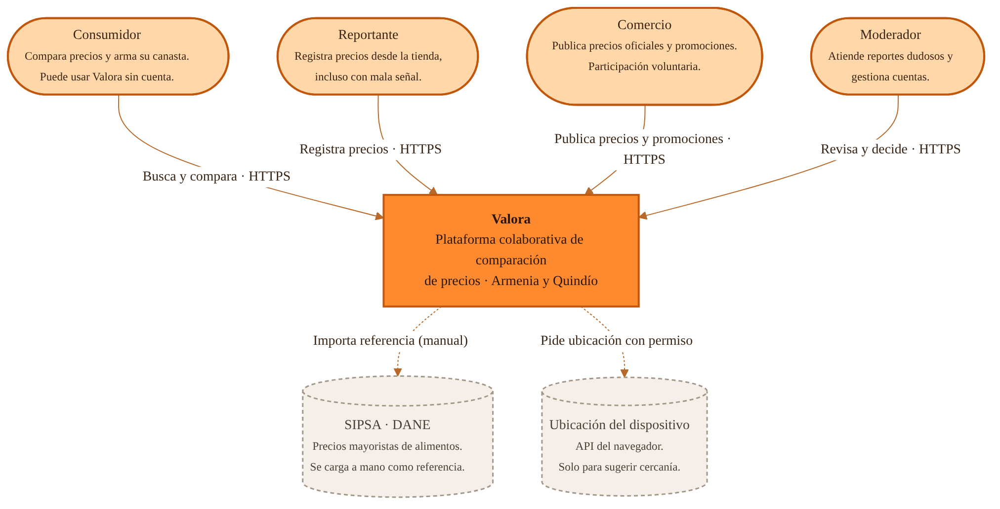

- La caja naranja intensa es el sistema que construye el equipo.
- Las cápsulas son personas; las cajas grises punteadas son sistemas externos que Valora no controla.
- No hay pagos, carrito ni domicilios: quedan fuera del alcance.

**Relación:** Guía §4.1 Actores · ADR-011 · RNF-007

Fuente: [`01-c4-contexto.mmd`](01-c4-contexto.mmd)

## 2. C4 nivel 2 · Contenedores

*Modelo C4 · obligatorio*

Abre la caja de Valora y muestra las piezas que se despliegan o ejecutan por separado y cómo se comunican.

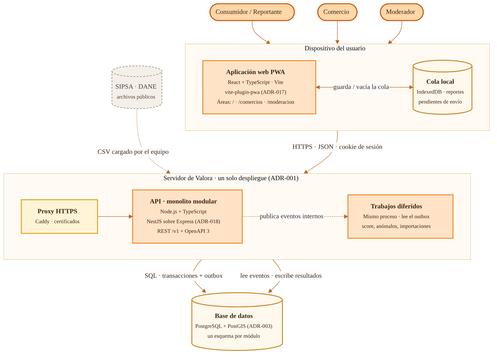

- En el dispositivo viven la aplicación web y su cola local; si no hay señal, el reporte espera ahí.
- En el servidor hay un solo despliegue: la API modular y los trabajos diferidos en el mismo proceso, en Render. Vercel sirve la PWA y reenvía `/v1/*` a esa API.
- Una sola base de datos PostgreSQL + PostGIS, con un esquema por módulo.
- Frameworks aceptados el 8 de noviembre de 2026: React + Vite con vite-plugin-pwa en el frontend (ADR-017) y NestJS sobre Express en el backend (ADR-018).

**Relación:** ADR-001 · ADR-002 · ADR-003 · ADR-010 · ADR-014

Fuente: [`02-c4-contenedores.mmd`](02-c4-contenedores.mmd)

## 3. C4 nivel 3 · Componentes del backend

*Modelo C4 · partes críticas*

Muestra los módulos internos de la API agrupados en tres capas y el recorrido de eventos que convierte un reporte en un precio comparable.

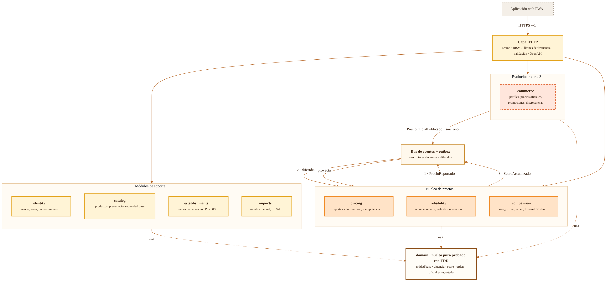

- Amarillo: módulos de soporte. Naranja claro: núcleo de precios. Coral punteado: módulo comercial que llega en el corte 3.
- Los números 1 a 4 siguen el camino de un reporte: pricing lo guarda, reliability lo evalúa, comparison lo proyecta.
- El precio oficial viaja por el bus como cualquier evento: se guarda en el outbox en la misma transacción que el precio y el repartidor lo entrega a `comparison` en segundos (ADR-023).
- Todas las reglas de negocio viven en domain, que no depende de nada y se prueba con TDD.

**Relación:** ADR-001 · ADR-004 · ADR-015 · RNF-005 · RNF-006

Fuente: [`03-c4-componentes.mmd`](03-c4-componentes.mmd)

## 4. Reglas de dependencia entre módulos

*Diagrama de paquetes*

Define quién puede usar a quién dentro del monolito. Es lo que evita que el monolito modular se vuelva un monolito enredado.

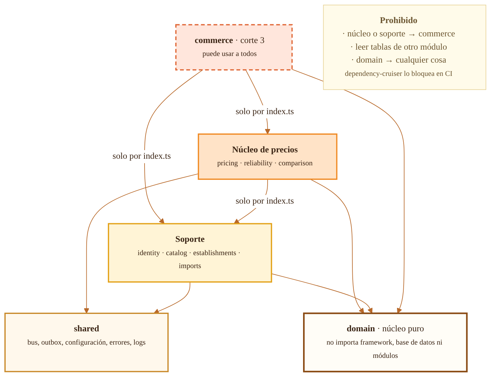

- Las flechas indican uso permitido, siempre a través de la interfaz pública index.ts de cada módulo.
- commerce puede usar al resto, pero nadie del núcleo depende de commerce: así se puede agregar en el corte 3 sin tocar el núcleo.
- Estas reglas se verifican de forma automática en el pipeline con dependency-cruiser.

**Relación:** ADR-001 · EC-05 · RNF-005

Fuente: [`04-dependencias.mmd`](04-dependencias.mmd)

## 5. Casos de uso por actor

*UML · casos de uso*

Agrupa lo que cada actor puede hacer en Valora y en qué corte se construye.

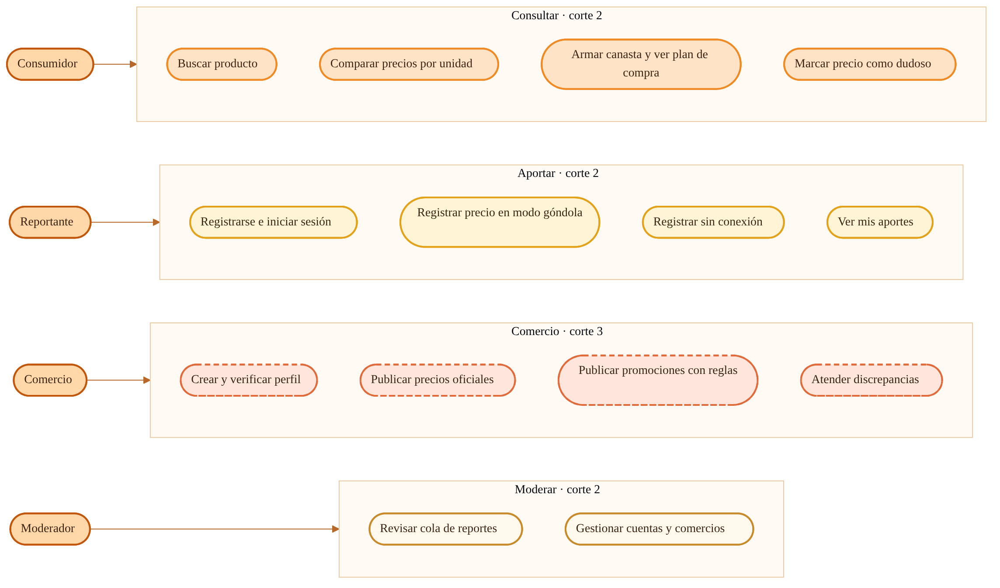

- Cada actor se conecta con su grupo de casos de uso.
- El reportante también es consumidor: usa todo lo de Consultar.
- El grupo de comercio (coral punteado) se construye en el corte 3, como exige la guía.

**Relación:** RF-001 a RF-019

Fuente: [`05-casos-de-uso.mmd`](05-casos-de-uso.mmd)

## 6. Secuencia · registrar un precio

*UML · secuencia*

Detalla el flujo más crítico: registrar un precio desde la tienda, con o sin señal, sin duplicados y con validación de confianza.

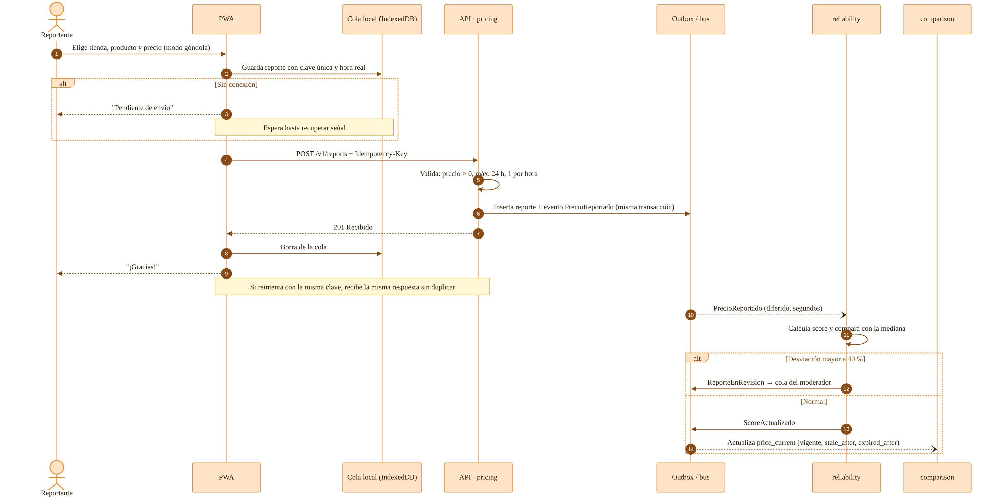

- Primero se guarda en el teléfono; si no hay señal, queda pendiente.
- La clave de idempotencia garantiza que un reintento no cree un reporte repetido.
- La respuesta al usuario es inmediata; el cálculo de confianza ocurre segundos después.
- Si el precio es atípico queda en revisión y no se muestra como vigente.

**Relación:** RF-006 · RF-007 · RF-012 · EC-01 · EC-03 · EC-07 · ADR-010

Fuente: [`06-sec-registro.mmd`](06-sec-registro.mmd)

## 7. Secuencia · consultar y comparar

*UML · secuencia*

Muestra cómo se responde una consulta rápida y neutral, sin depender de trabajos programados.

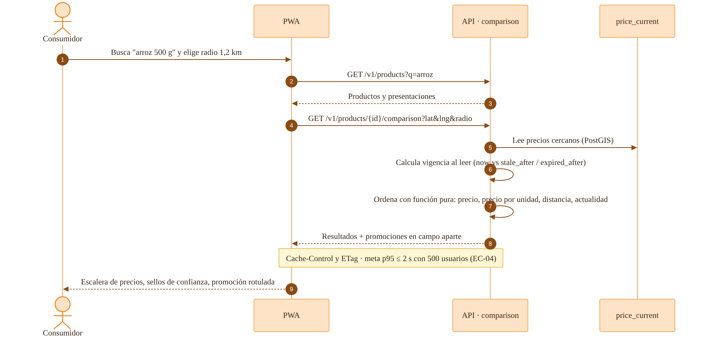

- Se lee una tabla ya calculada, por eso es rápida.
- La vigencia se decide al leer comparando la hora actual con stale_after y expired_after.
- El orden lo calcula una función pura con criterios declarados; las promociones vienen en un campo aparte.

**Relación:** RF-008 · RF-009 · RF-010 · EC-04 · EC-06 · ADR-004 · ADR-009

Fuente: [`07-sec-consulta.mmd`](07-sec-consulta.mmd)

## 8. Secuencia · precio oficial y promoción

*UML · secuencia · corte 3*

Muestra cómo un comercio publica su precio oficial y una promoción, y cómo se le avisa si la comunidad reporta otro valor.

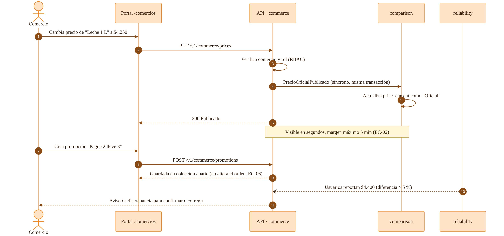

- El precio oficial se refleja en la comparación en la misma transacción.
- La promoción se guarda aparte y nunca cambia el orden.
- Si la comunidad reporta un valor que difiere más de 5 %, el comercio recibe un aviso para confirmar o corregir.

**Relación:** RF-016 · RF-017 · RF-018 · EC-02 · EC-06 · ADR-008 · ADR-009

Fuente: [`08-sec-oficial.mmd`](08-sec-oficial.mmd)

## 9. Ciclo de vida de un precio

*UML · máquina de estados*

Recorre todos los estados por los que pasa un precio, desde que se registra hasta que se reemplaza o se descarta.

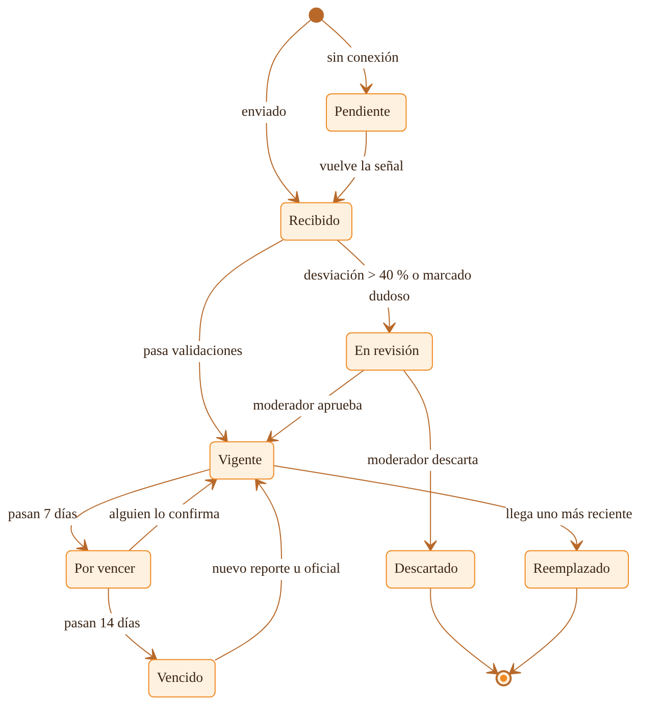

- Solo los estados Vigente y Por confirmar cuentan para el promedio y para el sello de más barato.
- El TTL depende de la categoría (ADR-005): 7 días para frescos y 14 para el resto son valores de partida provisionales, que se deben calibrar con evidencia de actualización de precios en comercios (todavía no existe).
- Un precio desactualizado revive si alguien lo confirma o si el comercio lo publica.
- La regla de vigencia está en `src/domain/freshness.ts` (issue #18).

**Relación:** RF-010 · RF-011 · EC-02 · ADR-005

Fuente: [`09-estados.mmd`](09-estados.mmd)

## 10. Flujo de moderación

*Diagrama de actividad*

Explica qué pasa con un precio dudoso: cómo llega a la cola, qué revisa el moderador y qué efecto tiene cada decisión.

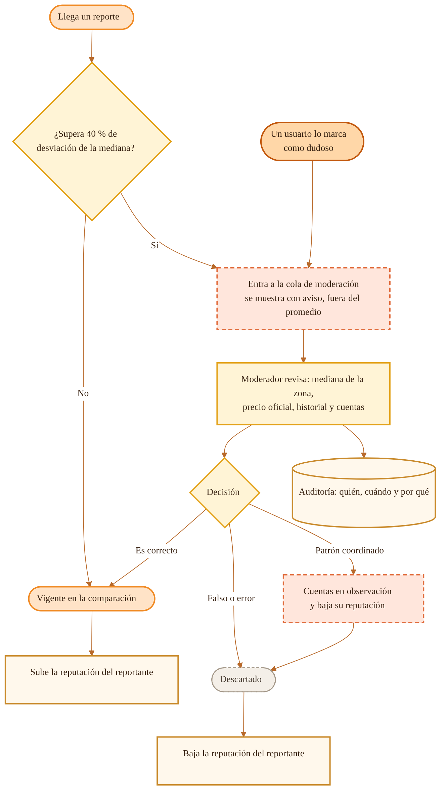

- Un precio llega a la cola por la regla de desviación o porque un usuario lo marcó.
- Mientras se revisa, se muestra con aviso y sin contar en el promedio.
- Cada decisión ajusta la reputación del reportante y queda auditada.

**Relación:** RF-012 · RF-013 · EC-03 · ADR-006 · ADR-013

Fuente: [`10-moderacion.mmd`](10-moderacion.mmd)

## 11. Modelo de datos

*Diagrama entidad-relación*

Presenta las entidades principales y cómo se relacionan. Cada grupo vive en el esquema de su módulo.

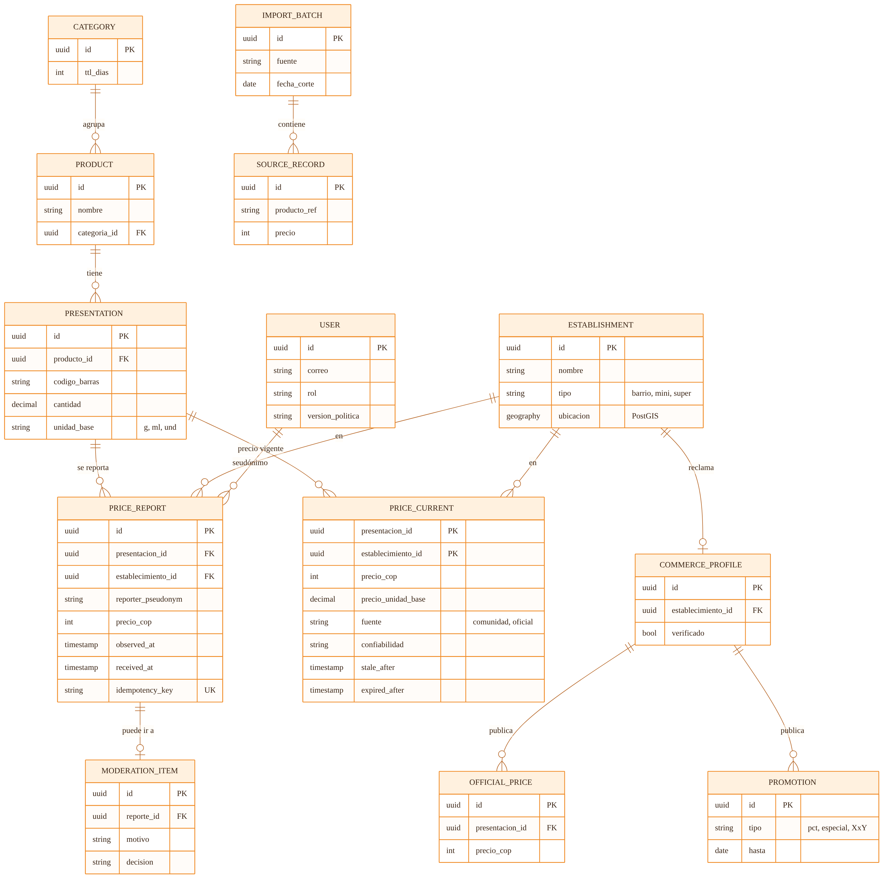

- PRICE_REPORT es de solo inserción: nunca se edita, solo se agregan reportes nuevos.
- PRICE_CURRENT es la tabla de lectura rápida y se puede reconstruir desde los reportes.
- El reportante aparece solo como seudónimo; la identidad vive aparte (ADR-013).
- Las entidades de comercio se agregan en el corte 3.

**Relación:** ADR-003 · ADR-004 · ADR-007 · ADR-013 · RNF-014

Fuente: [`11-datos.mmd`](11-datos.mmd)

## 12. Despliegue

*UML · despliegue*

Muestra dónde corre cada pieza y cómo llega el código a producción.

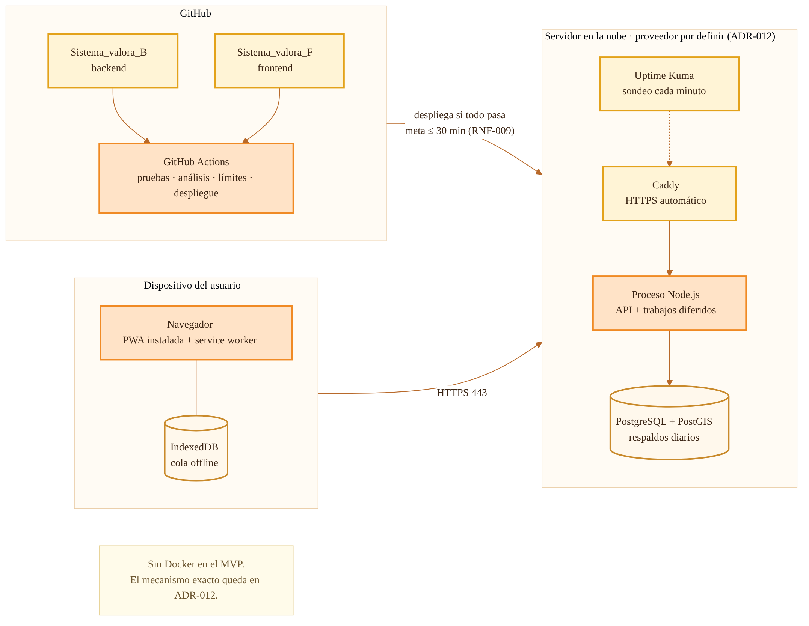

- El usuario solo necesita un navegador; la PWA se instala desde ahí.
- Vercel sirve la PWA; Render corre el proceso Node.js (imagen Docker); Neon guarda PostgreSQL con PostGIS; las fotos van a Supabase Storage.
- GitHub Actions prueba, analiza, verifica los límites de módulo y despliega solo si todo pasa.
- ADR-012 (aceptado el 16 de noviembre de 2026): el backend se despliega como una imagen Docker en Render; PostgreSQL + PostGIS en Neon y la PWA en Vercel.

**Relación:** ADR-012 · RNF-009 · RNF-011

Fuente: [`12-despliegue.mmd`](12-despliegue.mmd)

## 13. Evolución: del núcleo al módulo comercial

*Diagrama de impacto*

Anticipa el análisis de impacto del corte 2: qué se agrega, qué se ajusta y qué no se toca cuando llega el módulo comercial.

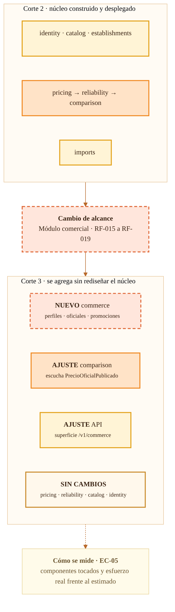

- Lo coral es nuevo, lo naranja se ajusta y lo crema no cambia.
- Si la arquitectura funciona, el núcleo no requiere rediseño estructural.
- El esfuerzo estimado aquí se compara con el real al final (EC-05).

**Relación:** EC-05 · RNF-005 · Entregables 4 y 6 de Arquitectura

Fuente: [`13-evolucion.mmd`](13-evolucion.mmd)
